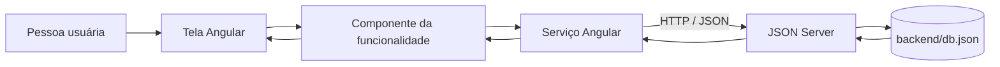

# Tutorial de implementação — Ateliê

Este tutorial explica a estrutura e os fluxos do sistema Ateliê, com ênfase em dados, API, serviços Angular e operações CRUD. O código atual é a referência: o backend é um **JSON Server**, que simula uma API REST usando um arquivo JSON. Não existe, nesta versão, um servidor de produção com banco de dados e autenticação segura.

## 1. Visão geral da arquitetura



Cada camada tem uma responsabilidade:

- **Tela/template:** apresenta dados e recebe ações.
- **Componente:** mantém o estado da tela, valida a interação e decide quando chamar um serviço.
- **Serviço:** concentra as chamadas HTTP a um recurso da API.
- **JSON Server:** transforma coleções do arquivo JSON em endpoints REST.
- **`db.json`:** armazenamento local simples usado durante o desenvolvimento.
- **Modelo TypeScript:** descreve o formato esperado de cada registro pelo frontend; não cria nem valida o banco por si só.

Essa separação facilita localizar problemas. Se um formulário não envia os dados, investigue o componente; se a URL ou o método HTTP estiver errado, verifique o serviço; se a resposta não tem o formato esperado, confira o arquivo e o endpoint.

## 2. Ambiente e execução

O projeto usa Angular 19.2, Angular Material, TypeScript, RxJS e JSON Server. A versão do Node.js precisa ser compatível com Angular 19.2; a [tabela oficial de versões do Angular](https://angular.dev/reference/versions) lista as faixas aceitas.

Na pasta `semestre-2/angular-crud-json`, instale as dependências:

```bash
npm install
```

Abra dois terminais nessa pasta. No primeiro, inicie a API:

```bash
npm run server
```

O script inicia o JSON Server na porta `3000`, lendo `backend/db.json`. No segundo terminal, inicie o Angular:

```bash
npm start
```

A interface abre em `http://localhost:4200`. A API fica em `http://localhost:3000`. Os dois processos precisam estar ligados para as telas conseguirem carregar e salvar dados.

## 3. Dados e modelo do domínio

O arquivo `backend/db.json` tem três coleções: `usuarios`, `clientes` e `pedidos`. Cada item tem um `id`, usado pelo JSON Server para identificar o registro. Neste projeto, IDs podem chegar ao Angular como texto ou número; por isso as assinaturas dos métodos aceitam `string | number`.

Exemplo reduzido de cliente e pedido:

```json
{
  "clientes": [
    {
      "id": "1",
      "usuarioId": "1",
      "nome": "Mariana Santos Oliveira",
      "cpf": "11144477735",
      "email": "mariana.santos@email.com",
      "telefone": "(19) 99876-1234"
    }
  ],
  "pedidos": [
    {
      "id": "1",
      "usuarioId": "1",
      "titulo": "Design de personagem",
      "descricao": "Concept art com três poses",
      "clienteId": "1",
      "clienteNome": "Mariana Santos Oliveira",
      "usuarioId": "1",
      "tipoArte": "Concept Art",
      "valor": 600,
      "dataEntrega": "2026-11-30",
      "status": "Pendente"
    }
  ]
}
```

O modelo [Cliente](src/app/core/models/cliente.model.ts) declara nome, CPF, e-mail e telefone. O modelo [Pedido](src/app/core/models/pedido.model.ts) declara título, descrição, cliente, categoria, valor, prazo e status. `StatusPedido` é uma união de valores permitidos (`Pendente`, `Em Andamento`, `Concluído` e `Cancelado`), ajudando o TypeScript a identificar valores incorretos no código.

Um pedido guarda `clienteId`, que funciona como referência ao cliente, e `clienteNome`, uma cópia do nome para facilitar a listagem. Em um banco relacional, normalmente o nome seria obtido por uma relação entre tabelas; no JSON Server o frontend faz essa associação e grava os dois campos.

Clientes e pedidos também possuem `usuarioId`. Esse campo identifica a conta proprietária. Os registros de demonstração existentes foram associados ao usuário `1` (`Artista Principal`); outro usuário, inclusive um criado pelo registro, começa sem clientes e pedidos próprios.

## 4. API REST do JSON Server

Uma coleção chamada `clientes` gera o recurso `/clientes`. Para `pedidos`, o recurso é `/pedidos`. O ID é acrescentado para trabalhar com um registro específico.

| Operação | Requisição | Resultado esperado |
|---|---|---|
| Listar clientes da conta 1 | `GET http://localhost:3000/clientes?usuarioId=1` | Array de clientes dessa conta |
| Buscar pedido 1 da conta 1 | `GET http://localhost:3000/pedidos?id=1&usuarioId=1` | Lista filtrada com o pedido correspondente |
| Criar cliente | `POST http://localhost:3000/clientes` | Novo cliente persistido |
| Atualizar pedido 1 | `PUT http://localhost:3000/pedidos/1` | Pedido substituído pelos dados enviados |
| Excluir cliente 1 | `DELETE http://localhost:3000/clientes/1` | Registro removido |

Exemplo de criação pelo PowerShell:

```powershell
$cliente = @{
  usuarioId = "1"
  nome = "Ana Souza"
  cpf = "52998224725"
  email = "ana@example.com"
  telefone = "11999990000"
} | ConvertTo-Json

Invoke-RestMethod `
  -Uri "http://localhost:3000/clientes" `
  -Method Post `
  -ContentType "application/json" `
  -Body $cliente
```

O `POST` cria um registro; normalmente o servidor atribui um ID. `PUT` envia o registro completo para atualizar. `DELETE` remove o recurso indicado. `GET` não altera dados. Como o JSON Server persiste os dados localmente, as mudanças aparecem em `backend/db.json`.

## 5. Serviços: a camada de acesso à API

O `HttpClient` é o cliente HTTP do Angular. Ele é disponibilizado à aplicação pelo provider global. Os serviços usam esse cliente para montar requisições e retornam `Observable`s tipados, como `Observable<Cliente[]>`. A listagem inclui o `usuarioId` do usuário conectado nos parâmetros; a busca por ID combina o ID do registro com o do proprietário.

O [ClientesService](src/app/core/services/clientes.service.ts) define a base `http://localhost:3000/clientes`. Listagem, busca, edição e exclusão recebem o `usuarioId`; a inclusão recebe o modelo com o proprietário. Seus métodos representam as operações CRUD:

```ts
listar(usuarioId: string | number): Observable<Cliente[]> {
  return this.http.get<Cliente[]>(this.API, {
    params: { usuarioId: String(usuarioId) }
  });
}

buscarPorId(id: number | string, usuarioId: string | number): Observable<Cliente> {
  return this.http.get<Cliente[]>(this.API, {
    params: { id: String(id), usuarioId: String(usuarioId) }
  }).pipe(
    map(clientes => {
      const cliente = clientes[0];
      if (!cliente) throw new Error('Cliente não encontrado para este usuário.');
      return cliente;
    })
  );
}

incluir(cliente: Cliente): Observable<Cliente> {
  return this.http.post<Cliente>(this.API, cliente);
}

editar(cliente: Cliente, usuarioId: string | number): Observable<Cliente> {
  return this.buscarPorId(cliente.id!, usuarioId).pipe(
    switchMap(() => this.http.put<Cliente>(`${this.API}/${cliente.id}`, { ...cliente, usuarioId }))
  );
}

excluir(id: number | string, usuarioId: string | number): Observable<void> {
  return this.buscarPorId(id, usuarioId).pipe(
    switchMap(() => this.http.delete<void>(`${this.API}/${id}`))
  );
}
```

O [PedidosService](src/app/core/services/pedidos.service.ts) repete a mesma ideia usando `/pedidos`. Centralizar as URLs e métodos evita duplicar HTTP em várias telas e torna mais simples trocar a API futuramente.

### Por que o método retorna um `Observable`?

Uma chamada HTTP leva tempo. O serviço devolve um `Observable`, que representa uma resposta que chegará no futuro. O componente se inscreve com `subscribe` e informa o que fazer em cada resultado:

```ts
this.service.listar(usuarioId).subscribe({
  next: (clientes) => {
    this.todosClientes = clientes;
    this.aplicarFiltro();
  },
  error: () => {
    // Informar que a API não respondeu.
  }
});
```

`next` trata a resposta bem-sucedida; `error` trata falhas de rede, API desligada ou recurso indisponível. O padrão aparece nas listas e formulários.

## 6. Fluxo CRUD de clientes

### Leitura e busca

Quando a lista é inicializada, `ngOnInit` chama `carregarClientes()`. O componente marca a tela como carregando, pede a lista ao serviço e, ao receber os dados, os guarda em `todosClientes`. `aplicarFiltro()` cria `clientesFiltrados` a partir do termo digitado. A tabela mostra os resultados filtrados; os dados originais continuam guardados para a busca poder ser recalculada.

### Cadastro e edição

O componente [ClientesFormComponent](src/app/features/clientes/form/clientes-form.component.ts) cria um formulário reativo com `FormBuilder`. Cada campo tem regras: nome obrigatório e com tamanho mínimo/máximo; CPF obrigatório e validado; e-mail obrigatório e com formato válido; telefone obrigatório e com limites de tamanho. O `usuarioId` não aparece como campo editável: o componente o obtém da sessão e o inclui no objeto enviado à API.

O formulário atende cadastro e edição. Sem `id` na rota, o modo é cadastro e salvar chama `incluir()` (`POST`). Com `/clientes/editar/:id`, o componente obtém o ID da rota, chama `buscarPorId()`, preenche os controles com `patchValue()` e salva usando `editar()` (`PUT`). Antes de enviar, verifica `form.invalid`; se inválido, marca os campos como tocados para mostrar os erros.

Antes de persistir, o CPF é normalizado com `replace(/\D/g, '')`, retirando pontos e traços. A interface pode aceitar o CPF formatado, enquanto o arquivo de dados mantém somente os dígitos.

### Validação do CPF

O [validador de CPF](src/app/core/validators/cpf.validator.ts) remove caracteres não numéricos, exige 11 dígitos, rejeita sequências repetidas e calcula os dois dígitos verificadores. A fórmula usa somas ponderadas e resto da divisão por 11. Ela detecta números inválidos matematicamente; não consulta uma base oficial nem confirma a titularidade.

### Exclusão

A tela pergunta se a pessoa confirma a exclusão. Se confirmada, chama `excluir(id)`, que executa `DELETE`. Após sucesso, o item também é removido do array local para a tabela atualizar sem uma nova navegação. A API continua sendo a fonte persistente; o ajuste local serve para refletir imediatamente a resposta.

## 7. Fluxo CRUD de pedidos

O [PedidosFormComponent](src/app/features/pedidos/form/pedidos-form.component.ts) carrega somente os clientes pertencentes ao usuário conectado pelo `ClientesService` e usa a resposta para preencher o seletor. Isso evita escolher clientes de outra conta na interface e mantém a associação dentro do conjunto visível ao artista.

O formulário valida título, descrição, cliente, categoria, valor, prazo e status. Ao salvar, localiza o cliente selecionado para obter o nome e monta o objeto `Pedido` com `clienteId`, `clienteNome` e o `usuarioId` da sessão. O valor é convertido para número antes de enviar. Cadastro chama `POST`; edição carrega o pedido pelo ID e pelo usuário proprietário, preenche os campos e chama `PUT`.

A lista deriva os indicadores do conjunto carregado. A busca compara o termo com título, cliente e categoria; o filtro de status é aplicado em conjunto com a busca. As ações de cada linha são:

- **Ver:** abre `PedidoDetalheDialogComponent` e passa o pedido por `MAT_DIALOG_DATA`; o diálogo só apresenta os campos.
- **Editar:** navega para `/pedidos/editar/:id`.
- **Excluir:** pede confirmação e chama `DELETE`.

O indicador “Faturamento Total” soma os valores dos pedidos registrados, independentemente do status. Não representa pagamentos confirmados.

## 8. Autenticação demonstrativa

O [AuthService](src/app/core/services/auth.service.ts) consulta `/usuarios?email=...`, compara e-mail e senha, e, se encontrar correspondência, guarda o usuário no `localStorage`. Um `BehaviorSubject` mantém o usuário atual disponível durante a execução da aplicação; o header usa esse estado para apresentar o perfil.

O [authGuard](src/app/core/guards/auth.guard.ts) verifica `estaAutenticado()` antes de permitir acesso às rotas internas. O logout remove `usuario_logado` do `localStorage`, limpa o estado do serviço e encaminha à tela de login.

**Limite de segurança:** não há autenticação real no servidor. A senha está em texto simples no `db.json`, e a verificação acontece no browser. O `localStorage` pode ser alterado pela própria pessoa usuária. Da mesma forma, o filtro por `usuarioId` organiza quais registros cada tela mostra, mas não configura autorização no JSON Server: alguém ainda poderia chamar diretamente a API e pedir outro `usuarioId`. Esse mecanismo é apropriado apenas para demonstração acadêmica; um sistema real deve autenticar no backend, armazenar senhas com hash, derivar o usuário da sessão/token e validar propriedade em cada consulta, alteração e exclusão.

Há uma tela, rota e link de registro ativos no código. Para deixar a criação de usuário desativada conforme a decisão do projeto, é necessário remover ou bloquear esses pontos; atualmente o método `registrar()` também envia um `POST` para `/usuarios`.

## 9. Rotas e layout

As rotas ficam em [app.routes.ts](src/app/app.routes.ts). `/login` e `/registro` são rotas públicas. Pedidos e clientes são rotas filhas do `AppLayoutComponent`, protegidas por `authGuard` na entrada e na navegação entre filhos.

O layout mantém a sidebar e o header montados enquanto o `RouterOutlet` troca o conteúdo central. `AppLayoutComponent` deriva breadcrumb da URL atual. `SidebarComponent` emite o evento de logout; o layout executa a operação no `AuthService` e muda a rota.

Alguns caminhos do CRUD original (`/cadastrar`, `/listagem`, `/consultar`, `/alterar/:id`, `/excluir`) redirecionam para as telas atuais para preservar compatibilidade com links antigos.

## 10. Como verificar a API manualmente

Com o JSON Server ligado, estas URLs podem ser abertas no navegador ou consultadas com `curl`:

```text
http://localhost:3000/usuarios
http://localhost:3000/clientes
http://localhost:3000/pedidos
http://localhost:3000/clientes/1
http://localhost:3000/pedidos/1
```

Se a interface exibir erro ao carregar, confira primeiro se o processo do JSON Server está ativo e respondendo na porta 3000. Depois confira a URL no serviço correspondente e se a coleção está escrita com o mesmo nome no `db.json`. Para um erro ao salvar, verifique o payload, o ID enviado em edição e o console/rede do navegador.

O projeto tem o comando `npm run build` para compilar. O comando `npm test -- --watch=false` está configurado, porém atualmente não existem arquivos `*.spec.ts`; por isso a execução informa que não encontrou testes.

## 11. Conceitos para apresentar

- **CRUD:** operações de criação, leitura, atualização e exclusão, implementadas com `POST`, `GET`, `PUT` e `DELETE`.
- **Separação de responsabilidades:** componentes gerenciam a tela; serviços concentram chamadas HTTP; modelos descrevem dados; o JSON Server persiste os registros de demonstração.
- **Formulário reativo:** campos são definidos e validados no TypeScript, e o template os conecta pelo `formControlName`.
- **Rota com parâmetro:** `:id` identifica qual registro carregar para edição.
- **Associação pedido-cliente:** `clienteId` relaciona os registros e `clienteNome` facilita a apresentação.
- **API REST simulada:** o projeto exercita integração frontend/backend sem implementar uma API própria.
- **MVC como referência:** modelos existem em `core/models`, a interface está em componentes e a lógica de acesso fica em serviços; por ser uma SPA Angular consumindo API, não é uma implementação clássica de MVC no servidor.

## 12. Limitações e evolução possível

O JSON Server não substitui um backend de produção. Uma evolução natural seria criar uma API própria, autenticação e autorização no servidor, persistência em banco de dados, hash de senhas, validação também no backend, tratamento consistente de erros e testes automatizados. Até lá, o `db.json` e os dados de demonstração devem ser tratados como ambiente local de estudo.
